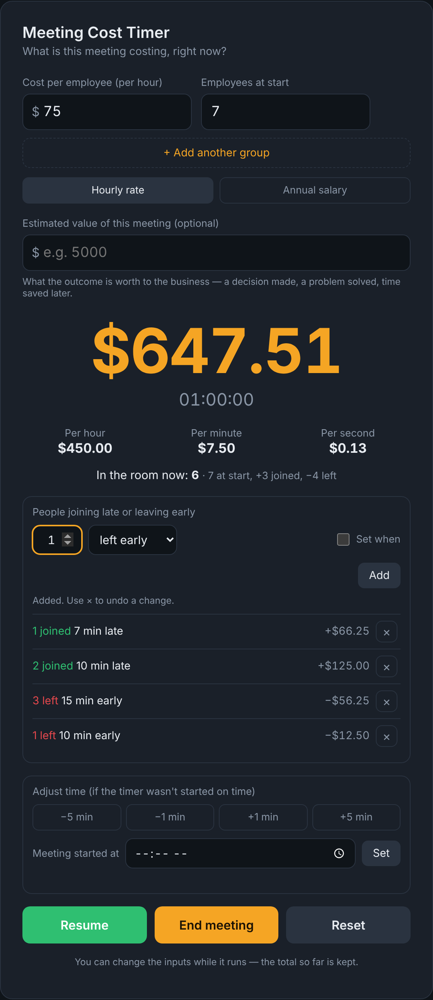
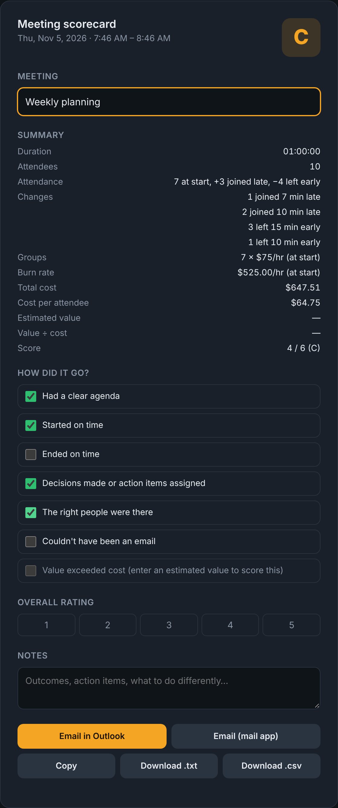

# Meeting Cost Timer

**See what a meeting really costs, live, while it's happening.**

Type in what people cost per hour and how many are in the room, press **Start**, and watch the dollar amount climb. When the meeting is over, you get a quick scorecard you can copy, download or email.



---

## What it does

- **Live cost counter.** Shows the running total, the time, what the meeting costs right now (per hour, minute and second), and the average cost per minute so far.
- **Fix mistakes any time.** Typed the wrong rate or headcount at the start? Just change it — the fix applies to the whole meeting.
- **Hourly rate or yearly salary.** Enter whichever you know. Yearly salaries are turned into an hourly rate based on a 40-hour week (2,080 hours a year).
- **Different pay levels in one meeting.** Use **+ Add another group** if, say, 3 managers and 6 staff are in the same meeting.
- **People who show up late or leave early.** Add them as they come and go, or tick **Set when** and say "2 people joined 10 minutes late" or "3 people left 15 minutes early". Each change can be undone with the **×**.
- **Started the timer late?** Nudge the clock with the −5 / −1 / +1 / +5 minute buttons, or enter the time the meeting actually started.
- **Is it worth it?** Optionally enter what the meeting's outcome is worth. The app shows whether the meeting is paying for itself.
- **Meeting scorecard.** Press **End meeting** to get a summary and a short checklist (clear agenda? started on time? could it have been an email?), a letter grade, a 1–5 rating and space for notes.
- **Share the results.** Copy them, download them as a text or spreadsheet (CSV) file, or open a ready-to-send email.



---

## How to use it

1. Enter the **cost per employee** (per hour, or switch to **Annual salary**).
2. Enter the number of **employees at start**.
3. Press **Start** when the meeting begins.
4. If people come in late or leave early, enter how many, pick **joined late** or **left early**, and press **Add**.
5. Press **End meeting** when you're done, fill in the checklist, and share the scorecard if you'd like.

**Reset** clears everything for the next meeting.

---

## Ways to run it

The whole app is one file: `index.html`. Pick whichever option suits you.

### Option 1: Just open the file (easiest)

Download `index.html` and double-click it. It opens in your web browser and works right away. Nothing to install, and no internet needed.

### Option 2: Run it with Docker

If you have [Docker](https://www.docker.com/products/docker-desktop/) installed, you can run the timer as a small website on your own computer or home server.

**With Docker Compose (simplest):**

```bash
git clone https://github.com/beltmattusa/meeting-cost-timer.git
cd meeting-cost-timer
docker compose up -d
```

Then open **http://localhost:8080** in your browser.

To stop it: `docker compose down`

**With plain Docker:**

```bash
docker build -t meeting-cost-timer .
docker run -d --name meeting-cost-timer -p 8080:8080 --restart unless-stopped meeting-cost-timer
```

**Good to know:**

- **Want a different port?** Change the first `8080` (for example `9090:8080`), then open http://localhost:9090.
- **Made changes to `index.html`?** Rebuild with `docker compose up -d --build`.
- **Running it on a NAS (like Synology)?** Use its container app to build from this folder, or copy the commands above. The timer will be at `http://<your-nas-address>:8080`.
- **Running it on Kubernetes or OpenShift?** The image runs as a regular, non-root user on port 8080, so it works there as is.

### Option 3: Put it on the web for free with GitHub Pages

1. On this repository's page, go to **Settings → Pages**.
2. Under **Source**, choose **Deploy from a branch**, pick **main** and **/(root)**, then **Save**.
3. After a minute or two, your timer will be live at `https://<your-username>.github.io/meeting-cost-timer/`.

---

## Your privacy

Everything happens in your own browser. The app doesn't save, send or collect anything, and there are no accounts, trackers or ads. The email buttons simply open your own email program with the summary filled in. You choose whether to send it.

---

## Common questions

**Where do I find the cost per employee?**
Use an average hourly rate. If you know salaries, switch to **Annual salary** and type the yearly amount. A common rule of thumb is to add 25–40% to salary for benefits and overhead if you want the "true" cost.

**How does "left early" timing work?**
Minutes are counted back from now (or from when you paused). You can add people the moment they leave, or after the meeting is over.

**Does it keep my numbers if I close the page?**
No. Closing or refreshing the page starts fresh. Copy or download the scorecard before you close it.

**Can I change the checklist questions or default numbers?**
Yes. Open `index.html` in any text editor and search for the words you want to change (for example `Had a clear agenda`, or `DEFAULT_RATE = 120` for the starting rate). Save the file and reopen it.

---

## License

Free to use, change and share under the [MIT License](LICENSE).
